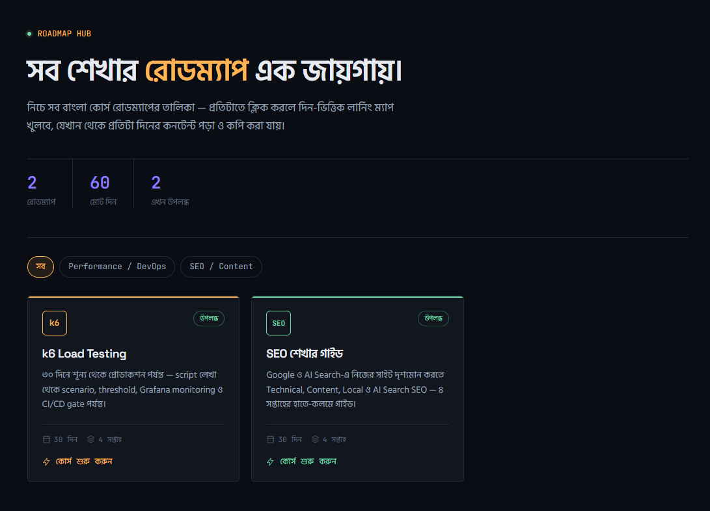

# Roadmap Hub

Static Bangla learning site. The home page lists every course. Each course opens as a day-by-day learning map.



## Run

```bash
    pnpm install
pnpm dev
```

Open [http://localhost:3000](http://localhost:3000).

`pnpm build` writes a static site into the `out` folder.

## Update content

| Change                | Edit                                                                      |
| --------------------- | ------------------------------------------------------------------------- |
| Home page course list | `src/content/catalog.ts`                                                  |
| A k6 day              | `src/content/k6/lessons/`, then add the day in `src/content/k6/meta.json` |
| SEO guide             | `src/content/seo/body.html`                                               |
| SEO map links         | `src/content/seo/nav.json`                                                |

Set a course to `"soon"` in the catalog to show it on the home page without a link. Set it to `"ready"` when the page exists.
